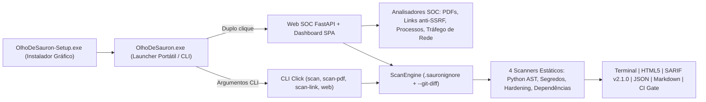

<div align="center">


# 👁️ Olho de Sauron
### Central SOC Defensiva (Setup Windows), Scanner DevSecOps CLI & Agente AppSec

[](https://dio.me)
[](https://github.com/marcossantosjrs-hue/olho-de-sauron/releases)
[](olho_de_sauron/web/app.py)
[](olho_de_sauron/cli.py)
[](olho_de_sauron/rules_catalog.py)
[](tests/)

> **Olho de Sauron** é uma suíte completa de **cibersegurança defensiva** pronta para instalar e rodar localmente no Windows (**`OlhoDeSauron-Setup.exe`**) ou usar em pipelines **DevSecOps / CI/CD**. Inclui **Interface Web SOC** (análise de **PDFs**, **Links anti-phishing**, **Processos da máquina** e **Tráfego de rede** em tempo real), **Scanner CLI (`sauron`)** com saída **HTML** e **SARIF v2.1.0**, além da especialização do [DIO Agent](https://github.com/digitalinnovationone/dio-agent).

[Download Setup Windows](#-instalação-rápida-no-windows-olhodesauron-setupexe) •
[Interface Web SOC](#-interface-web-soc-interativa) •
[Scanner CLI](#-scanner-devsecops-cli-sauron) •
[Arquitetura](#️-arquitetura-da-ferramenta) •
[Como Compilar](#-como-compilar-o-setup-e-o-executável-localmente) •
[Agente DIO](#-especialização-do-agente-e-por-quê) •
[Laboratório](#-laboratório-e-validação-prática) •
[Estrutura](#️-estrutura-do-repositório)

</div>

---

## ⬇️ Instalação Rápida no Windows (`OlhoDeSauron-Setup.exe`)

Quem quiser usar o programa em outra máquina **não precisa baixar o repositório nem instalar Python**: basta baixar o instalador pronto na aba [**Releases do GitHub**](https://github.com/marcossantosjrs-hue/olho-de-sauron/releases).

| Arquivo na Release | Para quem é | O que inclui |
| :--- | :--- | :--- |
| **`OlhoDeSauron-Setup.exe`** *(Recomendado)* | Usuário final Windows (instalação tradicional) | Assistente gráfico em tema escuro que instala em `%LocalAppData%\Programs\Olho de Sauron` (sem exigir Admin), cria atalho na **Área de Trabalho** e no **Menu Iniciar** com o ícone do Olho de Sauron, registra em *Aplicativos Instalados* com `Desinstalar.bat` e já abre o painel no navegador |
| **`OlhoDeSauron.exe`** *(Portátil)* | Uso direto sem instalação / pendrive / CLI | Executável único standalone — basta dar duplo clique para abrir o painel Web ou passar comandos no terminal |
| **`*.sha256`** | Verificação de integridade | Checksums SHA-256 oficiais para validar os binários baixados |

### Como usar após instalar

1. Baixe e execute **`OlhoDeSauron-Setup.exe`** → clique em **Instalar Agora**.
2. Ao concluir, o navegador abrirá automaticamente a **Central SOC Defensiva** (`http://127.0.0.1:8000`).
3. Para abrir novamente depois, basta clicar no atalho **Olho de Sauron** na Área de Trabalho ou no Menu Iniciar.

> [!TIP]
> Para conferir a integridade do instalador baixado no PowerShell:
> ```powershell
> Get-FileHash .\OlhoDeSauron-Setup.exe -Algorithm SHA256
> ```

---

## 🖥️ Interface Web SOC Interativa

O painel Web local (**FastAPI + SPA autocontida sem dependências externas**) reúne 5 módulos defensivos em tempo real:

```bash
# Caso esteja rodando pelo código-fonte Python:
python -m olho_de_sauron web
# Ou pelo executável instalado / portátil:
OlhoDeSauron.exe
```

| Módulo | O que analisa na prática | Proteções / Técnicas |
| :--- | :--- | :--- |
| **📄 Scanner de PDFs** | Analisa `.pdf` sem abrir ou renderizar o arquivo, checando `/JavaScript`, `/JS`, `/OpenAction`, `/AA`, `/Launch`, `/EmbeddedFile`, `/XFA`, ofuscação por hex (`#xx`), metadados e SHA-256 | Extrai e audita automaticamente todas as URLs contidas no PDF (`sauron scan-pdf arquivo.pdf` na CLI) |
| **🔗 Analisador de Links** | Detecta esquemas perigosos (`javascript:`, `data:`, `file:`), `@` na URL, IPs literais, homógrafos Punycode (`xn--`), impersonação de bancos/marcas, encurtadores, TLDs abusados e download de executáveis | Verificação opcional de headers HTTP/TLS ao vivo com **bloqueio estrito anti-SSRF** contra IPs privados/loopback (`sauron scan-link URL`) |
| **⚙️ Processos da Máquina** | Enumera processos ativos aplicando Threat Hunting: LOLBins com flags suspeitas (`-enc`, `downloadstring`), mascaramento de processos protegidos (`svchost.exe`, `lsass.exe`), execução em `Temp`/`Public`, dupla extensão (`.pdf.exe`), mineradores e filhos de Office/PDF | Funciona nativamente no Windows via Win32 Toolhelp32 / `psutil` e em Linux/macOS |
| **🌐 Tráfego de Rede** | Mostra conexões ativas (`ESTABLISHED`, `LISTEN`), correlação com PID/processo, taxa **Download/Upload (KB/s)** em **gráfico SVG em tempo real** e alertas de portas C2, pools de mineração, serviços expostos em `0.0.0.0` e LOLBins conectando à internet | Snapshot sob demanda ou monitoramento automático ao vivo (a cada 3s) |
| **🔎 Código DevSecOps** | Executa os 4 motores estáticos (SAST AST, Segredos, Hardening e Dependências) em arquivos ou pastas locais direto pelo painel | Integra o fluxo *Shift-Left* da CLI na interface visual |

---

## ⚡ Scanner DevSecOps CLI (`sauron`)

Além da interface gráfica, o **Olho de Sauron** funciona como CLI para desenvolvedores, pré-commits (`--git-diff`) e esteiras **CI/CD no GitHub Actions**.

### 🚀 Instalação e Comandos Principais

```bash
# 1. Clone o repositório
git clone https://github.com/marcossantosjrs-hue/olho-de-sauron.git
cd olho-de-sauron

# 2. Instale a CLI em modo editável (Python 3.10+)
pip install -e .
```

```bash
# Varredura completa no projeto atual (exibe no terminal + gate de saída)
sauron scan .

# Analisar apenas arquivos modificados/novos no Git local (pré-commit)
sauron scan --git-diff

# Gerar Dashboard HTML interativo, SARIF v2.1.0 (GitHub Security), JSON e Markdown
sauron scan . --html reports/sauron.html --sarif reports/sauron.sarif --json-out reports/sauron.json --md-out reports/sauron.md

# Analisar um PDF ou URL suspeita direto do terminal
sauron scan-pdf caminho/documento.pdf
sauron scan-link "https://exemplo.com" --live

# Abrir a interface Web SOC local
sauron web

# Listar todas as 25 regras catalogadas
sauron rules
```

> [!NOTE]
> Todos os comandos funcionam igualmente via `python -m olho_de_sauron ...` ou via `.\dist\OlhoDeSauron.exe ...`.

---

## 🏗️ Arquitetura da Ferramenta



---

## 🔍 Motores Estáticos e 6 Pilares DevSecOps

Os 4 motores estáticos cobrem os 6 pilares definidos em [`docs/devsecops-checklist.md`](docs/devsecops-checklist.md):

| Motor | O que analisa | Exemplos de Regras (`25` no catálogo) | Pilares Cobertos |
| :--- | :--- | :--- | :--- |
| **`python-ast`** | Análise estática via Árvore Sintática Abstrata (AST) | `SAURON-SQLI-001` (SQLi em `.execute()`), `SAURON-INJ-002` (`shell=True`/`os.system`), `SAURON-INJ-003` (`eval`/`exec`), `SAURON-DESER-004` (`pickle`/`yaml.load`), `SAURON-CRYPTO-005` (`MD5`/`SHA-1`), `SAURON-CFG-006` (`verify=False`), `SAURON-ERR-008`, `SAURON-LOG-009` | Entradas e Injeções, Autenticação, Configurações, Logs e Erros |
| **`secrets`** | Chaves de provedores, PEM, URIs de banco, atribuições hardcoded + entropia de Shannon (com mascaramento `***REDACTED***`) | `SAURON-SEC-001` (AWS/GitHub/Slack/Stripe/Google), `SAURON-SEC-002` (Private Key), `SAURON-SEC-003` (DB URI), `SAURON-SEC-004` (Hardcoded), `SAURON-SEC-005` (`.env` real) | Segredos e Credenciais |
| **`config-hardening`** | `Dockerfile`, `docker-compose.yml`, `sshd_config`, `nginx.conf`, CORS e flags `DEBUG` | `SAURON-INFRA-001` (`USER root`), `SAURON-INFRA-002` (`:latest`), `SAURON-INFRA-003` (`privileged`/`docker.sock`), `SAURON-INFRA-004` (`PermitRootLogin yes`), `SAURON-INFRA-005` (`server_tokens`/`TLSv1`), `SAURON-CFG-008` (CORS `*`), `SAURON-CFG-009` | Configurações e Exposição, Autenticação |
| **`dependencies`** | Manifestos `requirements*.txt` e `package.json` | `SAURON-DEP-001` (sem versão fixada), `SAURON-DEP-002` (versões vulneráveis conhecidas / pacotes abandonados), `SAURON-DEP-003` (índice `http://` sem TLS) | Dependências |

### 📊 Comparativo Real de Execução (`Antes` vs. `Depois`)

| Comando executado | Pontuação / Nota | Parecer | Exit Code | Resultado |
| :--- | :---: | :---: | :---: | :--- |
| `python -m olho_de_sauron scan lab/app_vulneravel.py` | `75/100` (Nota `C`) | **BLOQUEADO** | `2` | Detecta `SAURON-SQLI-001` (`CRITICAL`, OWASP `A03:2021`, MITRE `T1190`, `CWE-89`) na linha 34 |
| `python -m olho_de_sauron scan lab/app_seguro.py` | `100/100` (Nota `A`) | **APROVADO** | `0` | 0 achados; todos os 6 pilares com status `OK` |
| `python -m olho_de_sauron scan olho_de_sauron scripts installer --fail-on high` | `100/100` (Nota `A`) | **APROVADO** | `0` | Auto-varredura limpa em todos os 31 arquivos da ferramenta, build e instalador |

---

## 📦 Como Compilar o Setup e o Executável Localmente

Para gerar `dist/OlhoDeSauron.exe`, `dist/OlhoDeSauron-Setup.exe` e seus checksums `.sha256` do zero a partir do código-fonte:

```powershell
# 1. Instale as dependências do projeto e ferramentas de build
pip install -r requirements.txt
pip install pillow pyinstaller

# 2. Converta sauron-eye.webp em .ico/.png e compile portátil + instalador
python scripts/prepare_icon.py
python scripts/build_exe.py
```

No GitHub, a esteira [`.github/workflows/build-executable.yml`](.github/workflows/build-executable.yml) automatiza todo esse processo em `windows-latest` e publica os arquivos direto na aba **Releases** sempre que uma tag `v*` é enviada (`git tag v1.0.0 && git push origin v1.0.0`).

---

## 🎯 Especialização do agente (e por quê)

O **Olho de Sauron** também evolui o DIO Agent de um mentor genérico de estudos para um **mentor de segurança defensiva e DevSecOps**.

### Por que essa especialização?

Quem está aprendendo programação ou infraestrutura costuma focar primeiro em "fazer funcionar" — e só descobre problemas como *SQL Injection*, credenciais expostas no Git ou servidores mal configurados depois de um incidente.

Ao contrário de um chat genérico que despeja comandos ou código pronto sem entender o ambiente, este agente segue um roteiro estruturado que:

- **Pergunta o contexto antes de sugerir qualquer comando** (especialmente em servidores e infraestrutura);
- **Explica vulnerabilidade, ameaça, risco e tríade CID** em português claro, sem jargão desnecessário;
- **Mapeia riscos com frameworks de mercado** (**OWASP Top 10** e **MITRE ATT&CK**) e classifica **Impacto, Probabilidade e Severidade**;
- **Adota postura 100% defensiva e educativa**, conduzindo o estudante à correção em vez de entregar exploits ou respostas prontas de desafios;
- **Integra segurança ao fluxo de desenvolvimento (DevSecOps)** com checklist pré-produção e automação em CI/CD.

---

## 🧩 Melhoria DevSecOps no fluxo de desenvolvimento

1. **Checklist e Fluxo *Shift-Left*:** guia de verificação pré-deploy em [`docs/devsecops-checklist.md`](docs/devsecops-checklist.md) e fluxo completo em [`docs/devsecops-workflow.md`](docs/devsecops-workflow.md) cobrindo os 6 pilares.
2. **Automação em Pull Requests e CI/CD:** template de PR em [`.github/PULL_REQUEST_TEMPLATE.md`](.github/PULL_REQUEST_TEMPLATE.md) e esteira no GitHub Actions em [`.github/workflows/devsecops-check.yml`](.github/workflows/devsecops-check.yml) executando os testes do laboratório, a suíte de testes da ferramenta (`tests/`), auto-varredura com geração de **SARIF + HTML + Step Summary** e SAST complementar com Bandit.
3. **Skills do Agente:** [`skills/analise-vulnerabilidades/SKILL.md`](skills/analise-vulnerabilidades/SKILL.md), [`skills/testes-seguranca/SKILL.md`](skills/testes-seguranca/SKILL.md) e [`skills/trilha-ciberseguranca/SKILL.md`](skills/trilha-ciberseguranca/SKILL.md).
4. **Laboratório Comparativo:** ambiente local em [`lab/`](lab/README.md) demonstrando SQL Injection antes/depois com consulta parametrizada e hash `scrypt` + `salt`.

---

## 🚀 Como rodar o agente no harness

Este projeto segue o padrão aberto **`AGENTS.md`**, funcionando diretamente no **Google Antigravity** e em outros harnesses compatíveis (*Claude Code, Codex, OpenCode, Hermes*).

1. Abra a pasta do projeto no **Google Antigravity**.
2. O harness lê automaticamente [`AGENTS.md`](AGENTS.md), carrega [`agent/persona.md`](agent/persona.md) e reconhece todas as skills registradas.
3. Converse naturalmente pedindo análises de código, hardening de infraestrutura ou revisão DevSecOps.

<details>
<summary><strong>💬 Prompts recomendados para testar o agente</strong></summary>

```text
Atue como especialista em AppSec e analise o arquivo lab/app_vulneravel.py.
Encontre a falha, explique como ocorre a exploração de forma conceitual, cite a técnica do MITRE ATT&CK, avalie o risco na tríade CID e oriente a correção segura.
```

```text
Corrigi o login usando consulta parametrizada e hash de senha no arquivo lab/app_seguro.py.
Faça uma nova varredura para validar se o SQL Injection foi mitigado e aplique o checklist DevSecOps pré-produção.
```

```text
Tenho um servidor Ubuntu de laboratório exposto na internet. O que devo fazer para deixá-lo mais seguro?
```

</details>

---

## 🧪 Laboratório e Validação Prática

Todos os testes deste projeto foram executados exclusivamente em **código e ambientes próprios de laboratório** (SQLite em memória `:memory:`):

```bash
python -m unittest discover -s lab -p "test_*.py" -v
python -m unittest discover -s tests -p "test_*.py" -v
```

| Etapa | Alvo | Resultado | Status |
| :--- | :--- | :--- | :---: |
| **Laboratório SQLi** | [`lab/test_sqli_lab.py`](lab/test_sqli_lab.py) | 5 testes de regressão em SQLite `:memory:` | ✅ `5 tests OK` |
| **Suíte Completa (CLI, SOC Web e Setup)** | [`tests/`](tests/) | 45 testes unitários e de integração (AST, Segredos, Configs, Deps, PDF, Links, Processos, Rede, Web API, Launcher e Setup) | ✅ `45 tests OK` |
| **Infraestrutura extra** | [`lab/cenario-infra-ubuntu.md`](lab/cenario-infra-ubuntu.md) | Cenário de servidor Ubuntu exposto + configurações inseguras de SSH e Nginx | ✅ Pronto |

O comparativo detalhado das análises do agente está documentado em [`docs/evidencias-laboratorio.md`](docs/evidencias-laboratorio.md) e o guia de prints em [`docs/prints/README.md`](docs/prints/README.md).

---

## 🗂️ Estrutura do repositório

```text
olho-de-sauron/
├── pyproject.toml                         Empacotamento PEP 621 e entrypoint `sauron`
├── requirements.txt                       Dependências da aplicação e Web SOC
├── sauron-eye.webp                        Imagem original usada como ícone e logo
├── olho_de_sauron.spec                    Spec PyInstaller do executável portátil
├── olho_de_sauron_setup.spec              Spec PyInstaller do instalador gráfico Windows
├── .sauronignore                          Exclusões padrão do scanner
├── README.md                              Documentação completa (Setup, Web SOC, CLI e Agente)
├── AGENTS.md                              Definição do agente e tabela de skills
├── CLAUDE.md                              Atalho para Claude Code (importa AGENTS.md)
├── olho_de_sauron/                        Pacote principal do Scanner DevSecOps & SOC Web
│   ├── __init__.py                        Metadados e versão da ferramenta
│   ├── __main__.py                        Execução via `python -m olho_de_sauron`
│   ├── launcher.py                        Launcher standalone (abre Web no duplo clique ou CLI)
│   ├── cli.py                             Comandos Click (`scan`, `web`, `scan-pdf`, `scan-link`, `rules`)
│   ├── engine.py                          Orquestrador (`--git-diff`, `.sauronignore`, score e gate)
│   ├── models.py                          Enums (`Severity`, `Pillar`, `Verdict`) e dataclasses
│   ├── rules_catalog.py                   25 regras defensivas (OWASP, MITRE ATT&CK, CWE, CID)
│   ├── analyzers/
│   │   ├── pdf_scanner.py                 Scanner estrutural de PDFs (`pdfid` + links)
│   │   ├── link_scanner.py                Analisador anti-phishing e headers com anti-SSRF
│   │   ├── process_monitor.py             Threat Hunting em processos ativos da máquina
│   │   └── network_monitor.py             Monitor de conexões e tráfego RX/TX em tempo real
│   ├── web/
│   │   ├── app.py                         Backend REST FastAPI + rotas de favicon/logo
│   │   └── static/
│   │       ├── index.html                 Interface Web SOC interativa (6 abas + gráfico SVG)
│   │       ├── sauron_eye.ico             Ícone multi-resolução (256px..16px)
│   │       └── sauron_eye.png             Logo PNG (256x256)
│   ├── scanners/
│   │   ├── base.py                        Contrato base e supressão `# sauron: ignore`
│   │   ├── python_ast.py                  Motor SAST via AST Python
│   │   ├── secrets.py                     Detector de segredos + entropia + mascaramento
│   │   ├── configs.py                     Hardening (Dockerfile, Compose, SSH, Nginx, CORS, Debug)
│   │   └── dependencies.py                Auditoria de `requirements.txt` e `package.json`
│   └── reporters/
│       ├── terminal.py                    Saída Rich com fallback automático Colorama
│       ├── html_reporter.py               Dashboard HTML5 autocontido com filtros
│       ├── sarif_reporter.py              Relatório SARIF v2.1.0 para GitHub Security
│       ├── markdown_reporter.py           Resumo Markdown para PRs e Step Summary
│       └── json_reporter.py               Relatório JSON estruturado
├── installer/
│   └── setup_wizard.py                    Assistente gráfico Tkinter + modo `--silent` + atalhos
├── scripts/
│   ├── prepare_icon.py                    Conversor de `sauron-eye.webp` para `.ico`/`.png`
│   └── build_exe.py                       Compilador de `OlhoDeSauron.exe`, Setup e `.sha256`
├── tests/                                 Suíte completa (45 testes unitários e de integração)
├── .github/
│   ├── PULL_REQUEST_TEMPLATE.md           Checklist DevSecOps automático para Pull Requests
│   └── workflows/
│       ├── devsecops-check.yml            CI com testes, auto-varredura `sauron`, SARIF e Bandit
│       └── build-executable.yml           Build automático do Setup + Releases no GitHub
├── agent/                                 Persona e base de conhecimento do DIO Agent
├── skills/                                Skills especializadas (AppSec, Testes, Trilha, Estudos)
├── lab/                                   Laboratório comparativo SQLi (antes/depois)
└── docs/                                  Checklist DevSecOps, workflow Shift-Left e evidências
```

---

## 🛡️ Aviso Ético

> [!WARNING]
> Todo o conteúdo, código e testes presentes neste repositório têm **finalidade estritamente educacional e defensiva**. Os testes foram feitos exclusivamente em ambiente local controlado e código próprio de laboratório. Nunca aplique testes de segurança em sistemas ou redes sem autorização expressa.
